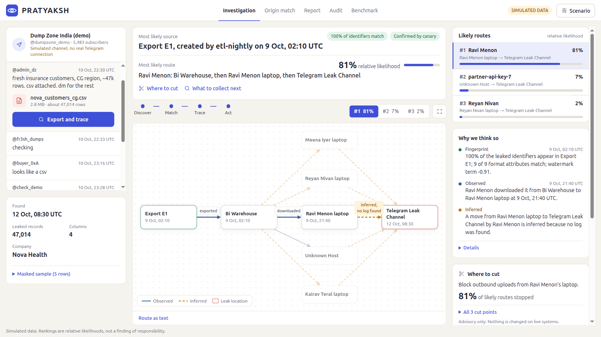
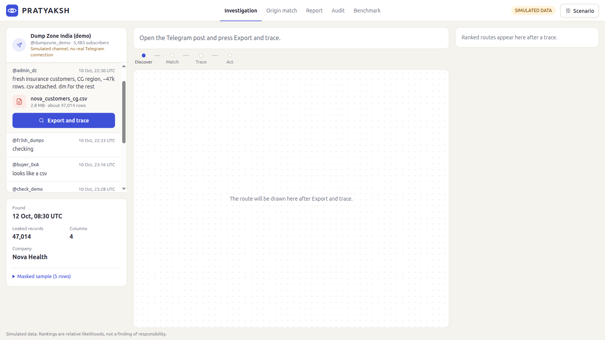
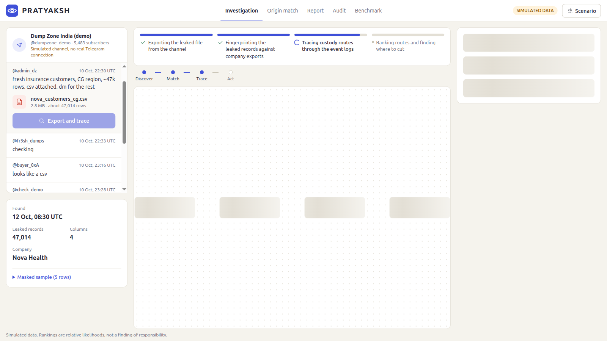
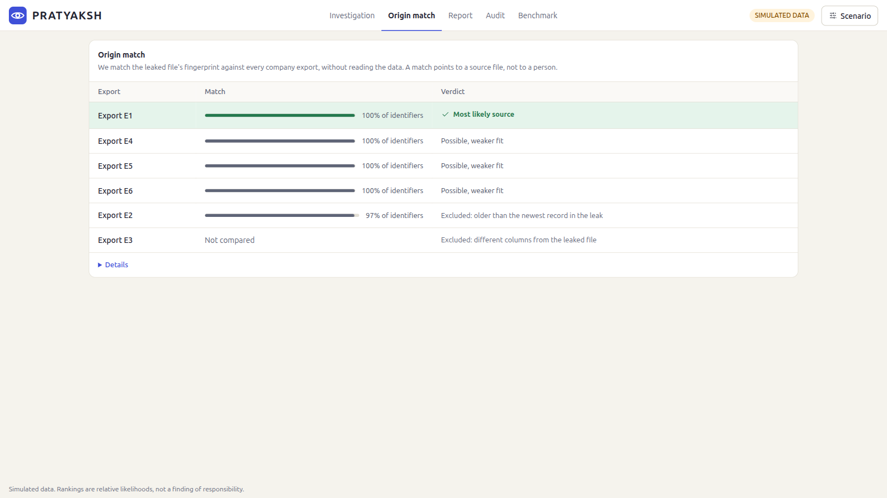
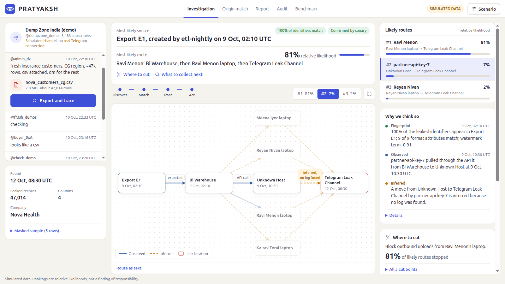
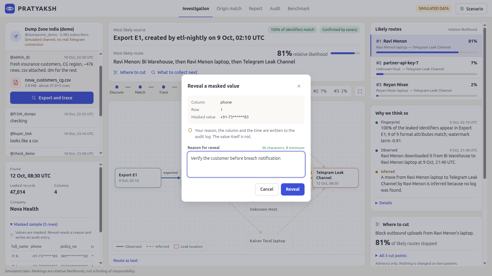
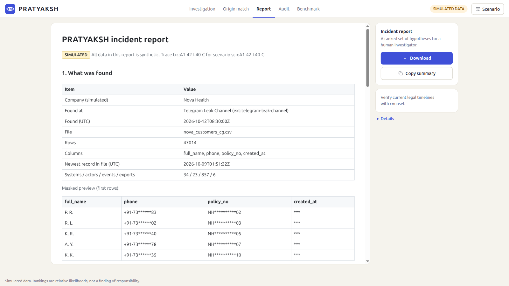
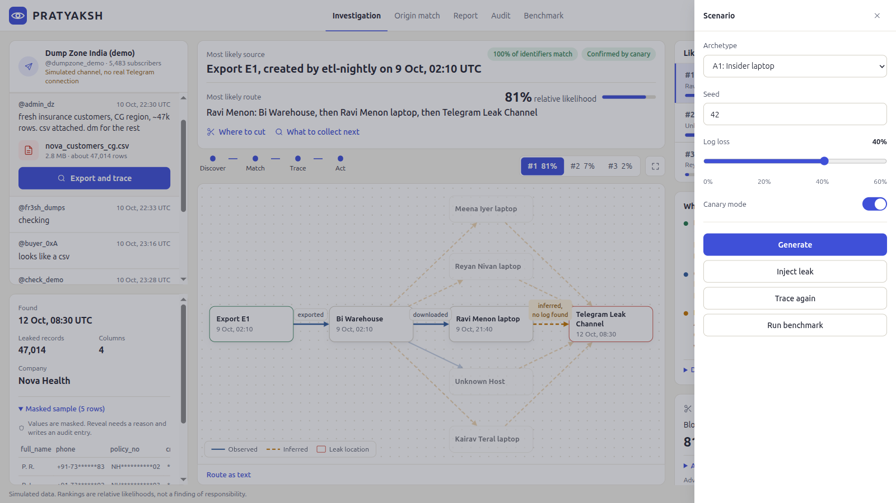
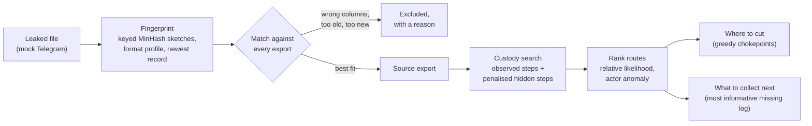
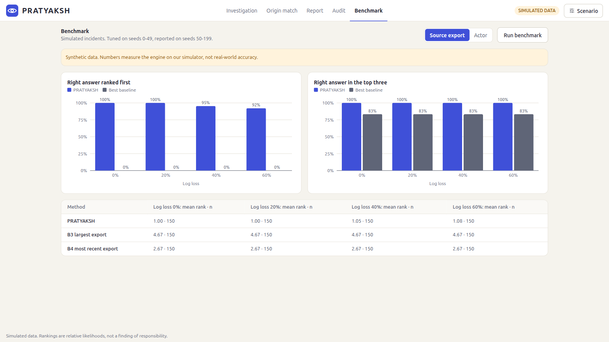

<div align="center">


# PRATYAKSH

### Trace a data leak back to its source, its route and the place to cut it

*Sanskrit: "directly evident". Built for INNOVATHON 2026, Problem Statement #18: Tracing a Data Leak Across Systems.*

[](https://www.python.org/downloads/)
[](https://fastapi.tiangolo.com)
[](https://react.dev)
[](https://www.typescriptlang.org)
[](https://tailwindcss.com)
[](#run-the-tests)
[](#offline-replay)



</div>

---

## The problem in one paragraph

A company's customer file shows up on a Telegram channel. Several systems, people and transfers could have moved it, and the logs are incomplete: some events were never recorded. Investigators need to narrow down **where the file came from**, **who most likely moved it**, and **what to do next**, without exposing more personal data along the way.

## What PRATYAKSH answers

| | Question | How PRATYAKSH answers it |
|:-:|---|---|
| **1** | **Source:** which company export is this file? | Matches the leaked file's *fingerprint* (keyed hashes of its identifiers, its format, its newest record) against every export. It never reads the raw data. |
| **2** | **Route:** who moved it, through which systems? | Searches the custody graph. Steps that are in the logs are drawn solid; steps with no log are *inferred*, drawn dashed and labelled. Routes are ranked by **relative likelihood**. |
| **3** | **Action:** where do we cut, and what do we collect next? | Picks the cut point that stops the most likely routes, and the one missing log that would settle the biggest open question. |

> All data in this project is **simulated**: a fictional company (Nova Health), fictional people and a mock Telegram channel. Rankings are relative likelihoods for a human investigator, not a finding of responsibility.

---

## The demo in four steps

| 1. Discover | 2. Match | 3. Trace | 4. Act |
|:-:|:-:|:-:|:-:|
|  |  |  |  |
| A post on a (simulated) Telegram channel carries `nova_customers_cg.csv`. Press **Export and trace**. | The file is exported, fingerprinted and matched; custody routes are searched and ranked. Each step is shown as it runs. | The answer banner reads the result in one line; the graph draws the route, solid where logged, dashed where inferred. | The source table shows the winning export and why every decoy was excluded, in plain words. |

**What the seed-42 case shows** (archetype A1, 40% log loss):

- **Source:** *Export E1*, made by the nightly ETL job on 9 Oct, 02:10 UTC. 100% of the leaked identifiers are in it, and planted canary records confirm it.
- **Decoys handled:** E2 is excluded because it is older than the newest record in the leak; E3 is excluded because its columns differ; E4 to E6 match the records but fit worse on timing.
- **Route #1, 81% relative likelihood:** Ravi Menon downloaded 47,682 rows from the BI warehouse to his laptop on 9 Oct at 21:40 UTC (his usual is about 251). The move from his laptop to the Telegram channel has **no log**, so it is inferred and labelled that way.
- **Where to cut:** block outbound uploads from Ravi Menon's laptop. This alone stops 81% of the likely routes.
- **What to collect next:** endpoint, proxy or DLP logs for Ravi Menon's laptop between 9 Oct, 02:10 and 12 Oct, 08:30 UTC.

---

## A closer look

<table>
<tr>
<td width="50%"><br><b>Compare routes.</b> Pick route #2 from the tabs, the list or the graph; all three stay in sync and the graph re-lays out with that route on one line.</td>
<td width="50%"><br><b>Masked by default.</b> Every personal value is masked. Revealing one needs a written reason of at least 8 characters, and the reveal is written to an append-only audit log.</td>
</tr>
<tr>
<td width="50%"><br><b>Incident report.</b> A ready-to-share report of the case, with download and copy-summary actions.</td>
<td width="50%"><br><b>Judge picks the culprit.</b> The Scenario drawer generates new cases, sets log loss, and injects a leak through any person the judge chooses. It traces again live.</td>
</tr>
</table>

---

## How it works



| Stage | What happens |
|---|---|
| **Fingerprint** | Identifier columns are normalised and hashed with HMAC-SHA256 under a per-case key; the 512 smallest hashes form a sketch. Raw records never reach the engine. |
| **Origin match** | Hard rules drop exports with missing columns or impossible timing. The rest are scored on containment, specificity, format similarity and a freshness watermark. |
| **Custody search** | Logged moves cost little. A move with no log costs more, and that cost depends on how lossy the relevant log source is, measured from gaps in its sequence numbers. |
| **Ranking** | Route scores combine origin fit, path cost and how unusual each actor's behaviour was, then become relative likelihoods with a softmax. |
| **Act** | Greedy chokepoints cover the most likelihood per action; the evidence request targets the hidden step whose answer would change the ranking most. |

<details>
<summary><b>The maths, in detail</b></summary>

#### 1. Keyed bottom-k MinHash containment
Each export $E$ and the leaked file $L$ get a bottom-$k$ sketch ($k = 512$) of their normalised identifier columns:

$$\text{hash}(x) = \text{HMAC-SHA256}(K_{\text{case}}, \text{normalize}(x))[:8]$$

The Jaccard estimate $J$ from the sketches gives the containment of the leak in the export:

$$C(L \subseteq E) = \frac{J \cdot (|L| + |E|)}{(1 + J) \cdot |L|}$$

#### 2. Origin fit

$$\text{origin\_fit}(E) = 5.0 \cdot \ln(\max(C, 0.001)) + 1.0 \cdot \ln\left(\text{clip}\left(\frac{|L|}{|E|}, 0.01, 1\right)\right) + 2.0 \cdot \text{format\_sim}(L, E) + \text{WM}(E)$$

The watermark term penalises an export made long after the newest record in the leak, because it should then contain fresher records that the leak lacks:

$$\text{WM}(E) = -\text{arrivals\_per\_hour} \times \Delta t_{\text{gap}}$$

#### 3. Custody paths with penalised hidden hops

$$c(\text{hop}) = \begin{cases} 0.10 & \text{observed in the logs} \\ 0.50 & \text{hidden, from an unmonitored laptop} \\ -\ln(p_{\text{loss}}) + 1.0 & \text{hidden, where a log source should have seen it} \end{cases}$$

$p_{\text{loss}}$ for each log source is estimated from gaps in its sequence numbers.

#### 4. Actor anomaly and relative likelihood

$$z = \frac{\ln(1 + \text{rows}) - \mu_{\text{actor}}}{\sigma_{\text{actor}}}, \qquad \text{anomaly} = \min(z, 4) + 0.5\,\mathbf{1}_{\text{off hours}} + 0.7\,\mathbf{1}_{\text{first time}} + 0.7\,\mathbf{1}_{\text{new privilege}}$$

$$S(\text{path}) = \text{origin\_fit} - \text{path\_cost} + 0.6 \sum_{a} \text{anomaly}(a), \qquad P(\text{path}) = \frac{e^{S(\text{path})}}{\sum_{p'} e^{S(p')}}$$

$P$ is a **relative likelihood** across the candidate routes, not a calibrated probability.

</details>

---

## Results on the simulator



150 simulated incidents per log-loss level (seeds 50 to 199; weights were tuned on seeds 0 to 49 only). "Best baseline" is the stronger of the simple baselines at each level.

**Finding the source export**

| Log loss | PRATYAKSH ranked 1st | Best baseline ranked 1st | PRATYAKSH in top 3 | Best baseline in top 3 |
|:-:|:-:|:-:|:-:|:-:|
| 0% | **100%** | 0% | **100%** | 83% |
| 20% | **100%** | 0% | **100%** | 83% |
| 40% | **95%** | 0% | **100%** | 83% |
| 60% | **92%** | 0% | **100%** | 83% |

**Finding the person who moved it**

| Log loss | PRATYAKSH ranked 1st | Best baseline ranked 1st | PRATYAKSH in top 3 | Best baseline in top 3 |
|:-:|:-:|:-:|:-:|:-:|
| 0% | **100%** | 3% | **100%** | 44% |
| 20% | **56%** | 3% | **61%** | 45% |
| 40% | **49%** | 4% | **57%** | 44% |
| 60% | **43%** | 9% | **51%** | 37% |

Baselines: *largest export* and *most recent export* for the source; *last accessor* and *biggest exporter* for the person.

> These numbers measure the engine on our own simulator, not real-world accuracy. Finding the person gets much harder as logs go missing, and the tables say so.

---

## Quick start

**Needs:** Python 3.11+, Node.js 20+.

```bash
git clone https://github.com/Tanish18906/PRATYAKSH.git
cd PRATYAKSH
```

<table>
<tr><th>1. Backend (terminal 1)</th><th>2. Frontend (terminal 2)</th></tr>
<tr><td>

```bash
python3 -m venv .venv
source .venv/bin/activate
cd backend
pip install -r requirements.txt
uvicorn app.main:app --port 8000
```

</td><td>

```bash
cd frontend
npm install
npm run dev
```

Open **http://localhost:5173**

</td></tr>
</table>

> Run a single uvicorn worker (the default). Scenarios, audit numbering and benchmark state live in one process.

**Smoke test** with the backend running:

```bash
curl -s http://127.0.0.1:8000/api/health
# {"status":"ok","contract_version":"1.0","engine_version":"1.0.0"}
python backend/scripts/smoke.py      # generate, export and trace; prints PASS or FAIL
```

### Offline replay

No backend? No network? The frontend falls back to `frontend/public/demo.json`, the seed-42 case precomputed by the same engine, and shows an **Offline replay** chip. The page still opens at the empty state, and Export and trace replays the bundled case. To rebuild the bundle:

```bash
python backend/scripts/make_demo_bundle.py
```

### Run the tests

```bash
cd backend && pytest -q                 # 262 tests: engine, simulator, API, hand-built cases H1 to H8
cd frontend && npm run build && npm run lint
```

---

## Built-in guardrails

| | |
|---|---|
| **Hashes, not data** | The engine compares keyed sketches and schema metadata, never raw rows. |
| **Masked by default** | Personal values are masked everywhere; a reveal needs a reason and is audited. |
| **Append-only audit** | Every generate, export, trace, reveal, report and benchmark writes one line to `backend/data/audit.jsonl`. |
| **Honest uncertainty** | Inferred steps are always dashed and labelled "no log found". Likelihoods are relative, never "confidence". |
| **Ground truth stays hidden** | The simulator keeps the true answer to itself; the engine only sees what an investigator would see. |
| **Deterministic** | Same seed, same scenario; same scenario, same trace. |

**Limits:** everything is simulated; there is no real Telegram monitoring. Leaks through channels with no digital trace (a photo of a screen) cannot be traced.

---

## Repository layout

```
PRATYAKSH/
├── backend/
│   ├── app/
│   │   ├── main.py          FastAPI routes
│   │   ├── config.py        every tunable weight, in one place
│   │   ├── models.py        Pydantic mirror of the data contract
│   │   ├── common/          shared HMAC MinHash sketching
│   │   ├── sim/             synthetic company, logs, loss and the mock Telegram leak
│   │   ├── engine/          origin match, custody search, anomaly, ranking, chokepoints
│   │   ├── privacy/         masking and the audit log
│   │   ├── report/          incident report
│   │   └── bench/           benchmark against simple baselines
│   ├── tests/               pytest suite
│   └── scripts/             smoke test, contract validator, demo bundle builder
├── frontend/
│   ├── src/
│   │   ├── components/      answer banner, provenance graph, routes, tabs, dialogs
│   │   ├── state/           app state and the investigation flow
│   │   └── utils/           layout, names, design tokens
│   ├── tests/               node:test suites
│   └── public/demo.json     offline replay bundle
└── assets/screenshots/      images used in this README
```

**Stack:** FastAPI and Pydantic v2 on the backend; React, Vite, TypeScript, Tailwind, Cytoscape.js and Recharts on the frontend. System fonts and inline icons only, so the UI works with no network.

---

## Team

- **Tanish Mishra** ([@Tanish18906](https://github.com/Tanish18906)): tracing engine, privacy layer, API, maths foundations.
- **Anmol**: synthetic data simulator, mock discovery UI, benchmark evaluation.

<div align="center"><sub>Built for INNOVATHON 2026 · Problem Statement #18 · All data simulated</sub></div>
